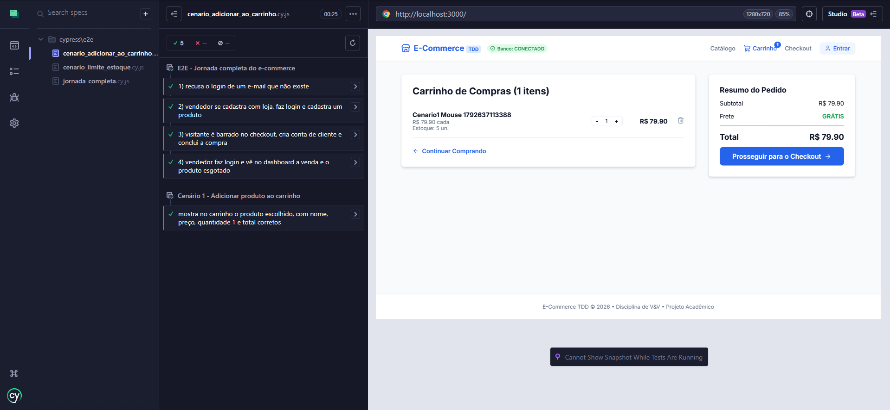
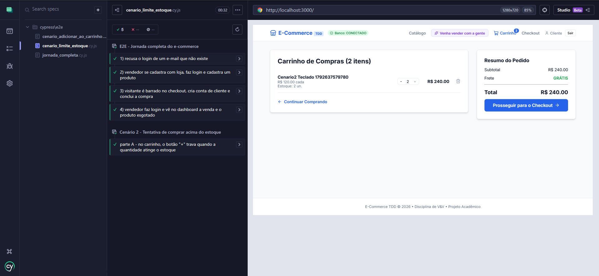

# Testes baseados em cenário

Dois cenários automatizados com Cypress, executados pela interface do sistema.

| Cenário | Tipo | Arquivo |
|---|---|---|
| 1 - Adicionar produto ao carrinho | Fluxo de sucesso | `Web/cypress/e2e/cenario_adicionar_ao_carrinho.cy.js` |
| 2 - Tentativa de comprar acima do estoque | Validação de regra de negócio | `Web/cypress/e2e/cenario_limite_estoque.cy.js` |

## Como executar

1. Backend na porta 8080, apontando para um PostgreSQL de teste.
2. Em `Web/`: `npm run dev` (porta 3000).
3. Em outro terminal, em `Web/`:

```powershell
# com janela (acompanhar o robô)
npm run cypress:open

# sem janela, os dois cenários
npx cypress run --spec "cypress/e2e/cenario_*.cy.js"

# sem janela, com vídeo como evidência (salvo em Web/cypress/videos)
npx cypress run --config video=true --spec "cypress/e2e/cenario_*.cy.js"
```

---

## Cenário 1: Adicionar produto ao carrinho

**Objetivo:** verificar se o cliente adiciona um produto ao carrinho e vê as informações corretas.

**Pré-condições**
- Sistema funcionando (o teste confere `GET /api/health`).
- Existe um produto cadastrado e disponível (criado pelo teste: preço R$ 79,90, estoque 5).
- A página de produtos está acessível.

**Passos**
1. Acessar a página de produtos.
2. Selecionar um produto.
3. Clicar em "Adicionar ao Carrinho".
4. Abrir o carrinho.

**Comparação: esperado x obtido**

| # | Resultado esperado | Obtido (previsto pelo código) | Confirmado na execução |
|---|---|---|---|
| 1 | O produto aparece no carrinho | O carrinho lista uma linha com o produto adicionado | [X] |
| 2 | Nome e preço correspondem ao produto selecionado | Nome idêntico ao do card; preço exibido como "R$ 79.90 cada", igual ao `79.90` do card | [X] |
| 3 | Quantidade inicial igual a 1 | Quantidade exibida: 1; título "Carrinho de Compras (1 itens)" | [X] |
| 4 | Valor total igual ao preço do produto | Subtotal do item, Subtotal e Total do resumo: "R$ 79.90" (frete grátis) | [X] |

**Status:** [X] Aprovado  [ ] Reprovado  Data da execução: 21/10/2026

---

## Cenário 2: Tentativa de comprar acima do estoque

**Objetivo:** verificar que o sistema não permite ao cliente comprar mais unidades do que há em estoque.

**Pré-condições**
- Sistema funcionando.
- Produto cadastrado com **2 unidades** em estoque (criado pelo teste).
- Cliente autenticado (criado pelo teste; o login é feito pela interface).
- Carrinho vazio.

**Passos: parte A (pelo carrinho)**
1. No catálogo, adicionar 1 unidade do produto.
2. Abrir o carrinho.
3. Aumentar a quantidade com o botão "+" até o limite do estoque.
4. Tentar aumentar novamente.


**Comparação: esperado x obtido**

| # | Resultado esperado | Obtido (previsto pelo código) | Confirmado na execução |
|---|---|---|---|
| A1 | A quantidade no carrinho não ultrapassa o estoque | O "+" leva a quantidade até 2 e fica desabilitado; o carrinho exibe "Estoque: 2 un." e total R$ 240,00 | [X] |


**Status:** [X] Aprovado  [ ] Reprovado  Data da execução: 21/10/2026

---

## Evidências



